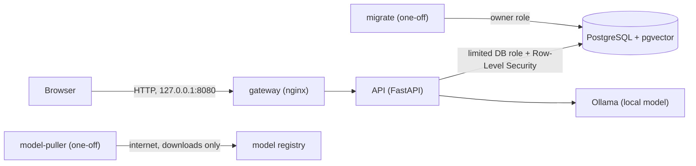

# Architecture

## Big picture

In the Docker release the database, API and model server sit on a Docker network marked `internal` (no route to the internet). The gateway is attached to that network and to a second network so the host can reach it. `model-puller` is a manual, one-off step that uses the internet only to download models.

## Components

| Part | Where | Job |
|---|---|---|
| Web app | `apps/web` | React + TypeScript screens. Shows what the API allows; enforces nothing. |
| API | `services/api/app` | Authentication, authorization checks, chat, documents, agents, organizations. |
| Policy engine | `policy.py`, `agent.py` | Decides whether a tool call is allowed, needs approval, or is denied. Plain code, no AI. |
| Retrieval | `rag.py` | Chunking, embeddings, similarity search, always filtered by owner. |
| Model provider | `providers.py` | One interface for chat and embeddings. Only local hosts are accepted. |
| Network guard | `network_guard.py` | Refuses outbound connections to public addresses inside the API process. |
| Organizations | `orgs.py`, `main.py` | Roles and role rules, tenant helpers. |
| Privacy status | `privacy.py` | Live checks behind the status page. |
| Retention job | `retention.py`, `scripts/run_retention.py` | Deletes old conversations for people who opted in. |
| Database | `migrations/` | Tables, grants, Row-Level Security policies, helper functions. |
| Release | `docker-compose.release.yml`, `deployment/containers/` | Containers, networks, hardening. |

## Request flow

1. The browser sends a request with a token.
2. The API checks the token and loads the user (a deleted or unknown user gets 401).
3. The API tells PostgreSQL who is asking (`app.current_user_id`, valid for one transaction only).
4. Role checks run in Python (`require_role`).
5. Every query runs under Row-Level Security, so the database returns only rows that person may see.
6. Sensitive steps write to an append-only audit table.
7. For AI features: retrieve only authorized text first, then build the prompt, then call the model.

## Trust boundaries

| Boundary | What we assume |
|---|---|
| Browser to API | The client is untrusted. Every rule is enforced on the server. |
| API to database | The API connects with a limited account that cannot bypass Row-Level Security. The database **trusts the API to state the user's identity honestly**, so SQL injection would be severe. We use bound parameters only. |
| API to model | The model is untrusted. It can propose, never decide. |
| Documents and retrieved text | Untrusted. Treated as data, never as instructions. |
| Container to internet | Blocked by the Docker internal network (release) or a Windows firewall rule (development, optional). |

## Two database accounts

- `verity` (owner): creates tables and runs migrations. Used only by the one-off `migrate` step.
- `verity_app`: used by the API. It is not a superuser and has no `BYPASSRLS`. Superusers skip Row-Level Security, which is why the split matters.

## Helper functions in the database

`app_current_user()`, `app_org_role(org)`, `app_user_in_org(org, user)` and `create_organization(name)` answer narrow questions or perform one controlled action. The ones that read across tables run as their owner (`SECURITY DEFINER`) with a fixed `search_path`, and only the app account may run them.
